<!-- Every card is an animated SVG drawn by scripts/render_readme_cards.py and refreshed daily by
     .github/workflows/update-profile-art.yml. Spacing is baked into the SVGs, so keep this block free of
     blank lines and keep each row of cards on one line with no spaces between the tags. -->

 
 
 
 
 
 
 
 
 

<a href="https://www.linkedin.com/in/arvardhan3/">linkedin</a> &nbsp;/&nbsp; <a href="https://github.com/Rajavardhan99?tab=repositories">repositories</a> &nbsp;/&nbsp; <a href="https://www.codechef.com/users/kl2400031694">codechef</a>

